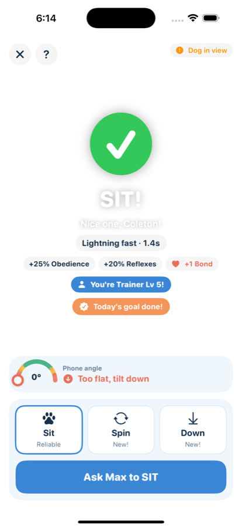
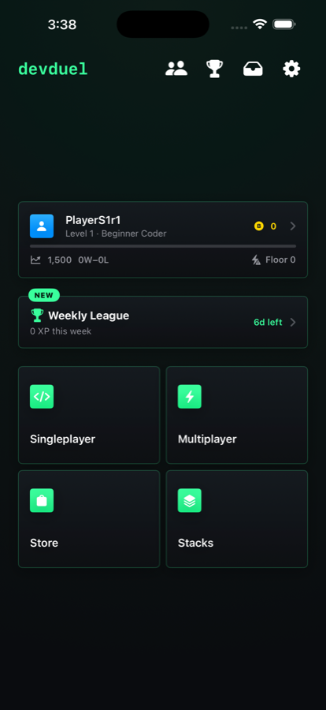
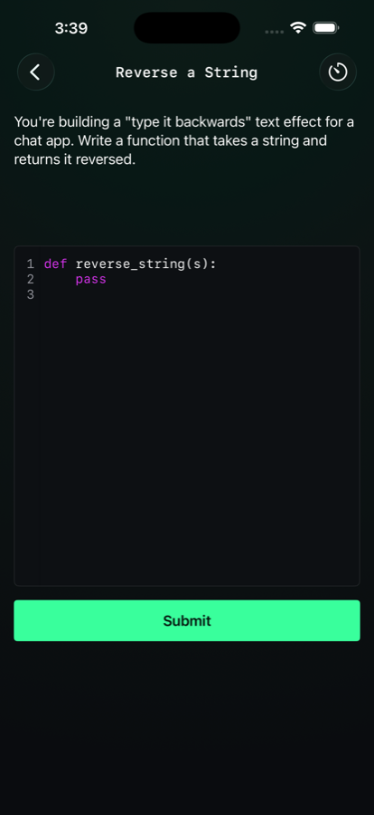
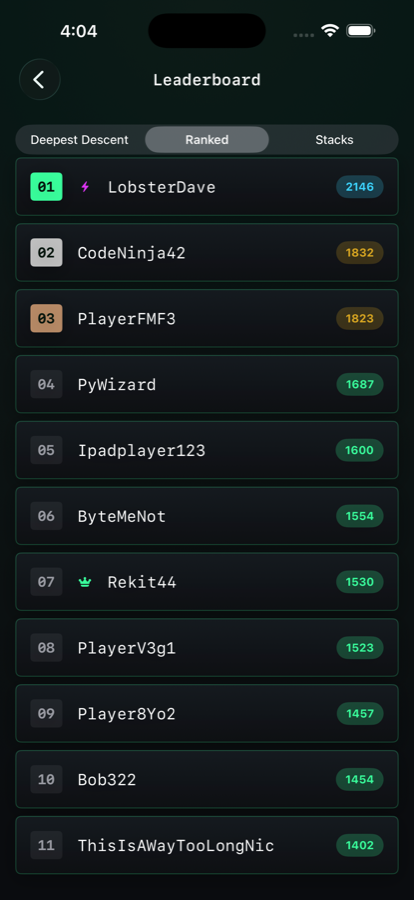

<h1 align="center">Hi, I'm Coleton 👋</h1>

  <b>iOS developer building games people actually want to play.</b> 
  Swift · SwiftUI · Firebase · Apple Vision & Core ML

  
  
  
  
  

---

### 🧑‍💻 About me

- 🐶 Building **Good Pup**, a game where your real dog levels up by doing tricks in front of the iPhone camera
- ⚔️ Built **DevDuel**, a competitive coding game for iOS with live 1v1 matches
- 🧪 Both apps are in **TestFlight with real outside testers**
- 📚 Self-taught and always learning, mostly by shipping things

> Most of my code lives in private repos. I'm happy to walk through any of it or give access on request.

---

### 🚀 Featured projects

<table>
<tr>
<td width="50%" valign="top">

#### 🐶 Good Pup
Your real dog does a trick, the camera sees it, your dog levels up.

- Dog pose detection on the phone with **Apple Vision**
- My own **Core ML** model for spin detection, trained on recordings of my dog
- **SwiftData + iCloud** backup, so your dog comes back on a new phone
- Community feed and leaderboards with **Firebase** + Sign in with Apple
- Tester data pipeline: testers' recordings upload so I can replay them on my Mac

`Swift` `SwiftUI` `Vision` `Core ML` `CloudKit` `Firebase`

**Status:** TestFlight beta 🧪

</td>
<td width="50%" valign="top">

  

</td>
</tr>
<tr>
<td width="50%" valign="top">

  
  
  

</td>
<td width="50%" valign="top">

#### ⚔️ DevDuel
A competitive coding game: solve Python problems against the clock or race another player live.

- **Live 1v1 matchmaking** with Elo ratings on Firebase
- **Segfault**, a roguelike mode with relics, classes and boss floors
- 170+ hand-checked problems with real code grading
- Daily challenge, weekly league, friends and in-app store

`Swift` `SwiftUI` `Firebase` `Firestore` `StoreKit`

**Status:** TestFlight beta 🧪

</td>
</tr>
</table>

---

### 🛠️ Smaller projects

| Project | What it does | Built with |
|---|---|---|
| [PokeNexusBot](https://github.com/coleton1/PokeNexusBot) | Bot that plays Pokémon browser games for you | Python |
| [SkiBeneion](https://github.com/coleton1/SkiBeneion) | Shows which hills are open at Ski Beneion and the grooming report | Python |
| [Warframe Riven Checker](https://github.com/coleton1/Warframe-RivenChecker) | Finds matching rivens on the market and what they sell for | Python |
| The Vault *(private)* | Desktop password manager with encryption and a strength checker | Python, Fernet, bcrypt |
